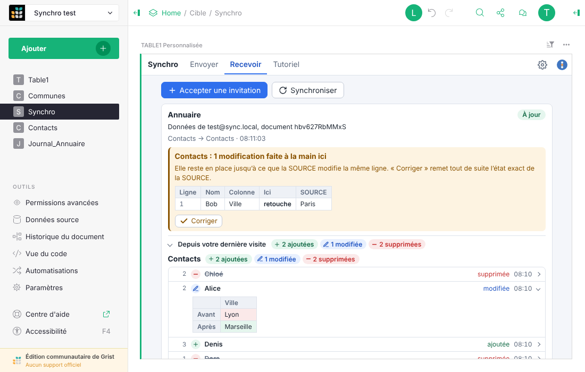
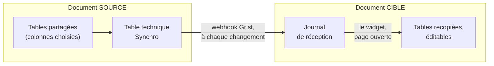
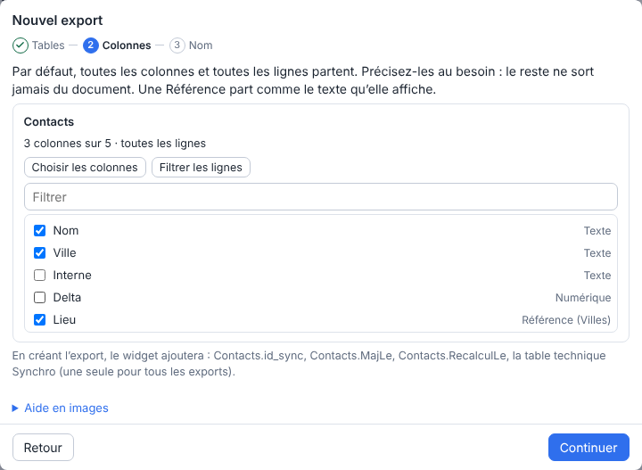
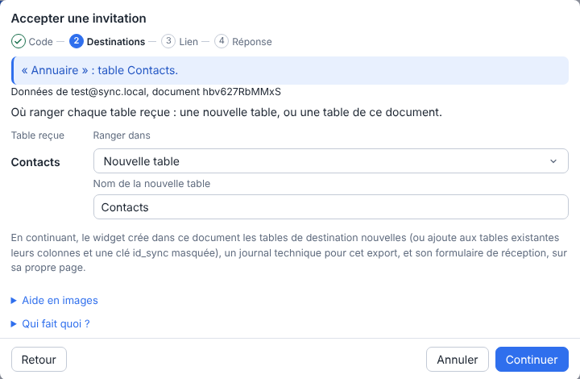
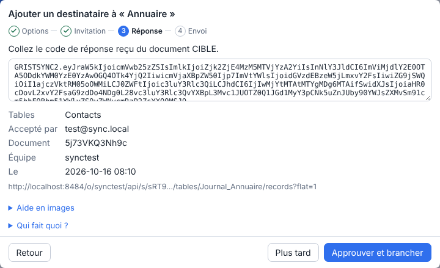

# Synchro Grist

**Recopiez des tables d'un document Grist dans un autre, tenues à jour toutes seules.** 
Sans serveur à héberger, sans dépendance, et seules les colonnes que vous choisissez sortent.

Version 0.5.9 · Grist 1.7.11 ou plus récent · licence GPL-3.0 · Grist Factory

## À quoi ça sert

Un service tient une table de référence dans Grist (contacts, établissements, nomenclature) et
d'autres équipes en ont besoin dans leurs propres documents. Synchro Grist leur en envoie une copie
qu'elles peuvent compléter, et la met à jour à chaque ajout, modification ou suppression dans
l'original.

- **Rien à héberger** : c'est Grist qui transporte les changements, même quand personne n'a le
  document ouvert.
- **Vous choisissez ce qui sort** : les tables, les colonnes et, en option, les lignes.
- **Chaque destinataire à part** : on en ajoute, on en met un en pause, on en révoque un sans
  toucher aux autres.
- **Dans les deux sens si besoin** : en mode Échange, deux documents se tiennent à jour l'un
  l'autre.

## comment installer les deux fichiers

Dans un document GRIST où la table de référence se trouve:
- créer une table puis une vue personnalisée liée à cette table.
- Choisir "widget custom builder".
- Cliquer sur "option de la vue", dans "niveau d'accès", choisir "accès complet au document".
- Cliquer sur "..." (au dessus de la vue personnalisée).
- cliquer sur "ouvir la configuration".
- Dans l'onglet html, copier - coller le contenu de syncplus-builder.html
- dans l'onglet javascrit, copier - coller le contenu de syncplus-builder2.js.
- Si vous avez un GRIST autohébergé: soit ajouter l'URL de votre GRIST dans la partie js/config.js  après "https://grist.numerique.gouv.fr", (aller à la ligne, ajouter "https://mongrist.mondom.fr",), soit remplacer les URL par celle de votre GRIST
- cliquer sur "preview"
- cliquer sur "enregistrer".
Dans le document devant réceptionner les mises à jour de la table de référence, refaire exactement les mêmes étapes que ci-dessus.

## Comment ça marche

Le document qui envoie (la **SOURCE**) et celui qui reçoit (la **CIBLE**) ont chacun le widget.
Dans la SOURCE, il prépare les lignes modifiées dans une seule table technique ; un webhook de
Grist les pousse aussitôt dans le journal de la CIBLE, par un formulaire qu'elle a publié pour
cela. Dans la CIBLE, le widget contrôle ce qui arrive et le recopie dans des tables normales dès
qu'un éditeur ouvre sa page.

## Brancher une synchro en trois étapes

Deux codes à copier-coller entre les deux personnes. Ils ne contiennent aucune donnée.

<table>
<tr>
<td width="33%" valign="top">

 <b>1. SOURCE : créer l'export</b> 
Choisir les tables et les colonnes, puis ajouter un destinataire. Le widget donne un
<b>code d'invitation</b>.
</td>
<td width="33%" valign="top">

 <b>2. CIBLE : accepter l'invitation</b> 
Coller le code, choisir où ranger chaque table, copier le lien du formulaire publié. Le widget
donne un <b>code de réponse</b>.
</td>
<td width="33%" valign="top">

 <b>3. SOURCE : approuver</b> 
Coller la réponse, vérifier qui a accepté, <b>Approuver et brancher</b>. Les lignes existantes
partent, puis chaque modification.
</td>
</tr>
</table>

## Fonctionnalités

- **Exports** : plusieurs par document, chacun avec ses tables, ses colonnes et un filtre de
  lignes ; une modification de l'export vaut pour tous ses destinataires.
- **Trois modes par destinataire** : *dans un seul sens* (deux codes, l'envoi est fait par Grist même
  page fermée), *Échange* (dans les deux sens, la modification la plus récente l'emporte) et
  *lien public* (un seul code, la CIBLE lit ce que la SOURCE publie).
- **Recopie fidèle** : ajouts, modifications, suppressions, valeurs venues d'une autre table
  (Référence, formule), annulation (Ctrl+Z).
- **Destinations au choix** : table nouvelle ou existante, colonnes mises en correspondance,
  lignes déjà présentes rattachées. Une table ajoutée plus tard à l'export est proposée dans une
  fenêtre.
- **Retouches respectées** : une valeur corrigée, une ligne ou une colonne supprimée à la main
  dans la CIBLE reste ainsi jusqu'au prochain changement de la ligne dans la SOURCE, et la carte la
  signale une dizaine de secondes après, avec le détail (ligne, valeur d'ici, valeur de la SOURCE)
  et un bouton « Corriger » qui remet l'état exact de la SOURCE.
- **Grandes tables** : pas de limite de lignes (testé avec 21 000), gros imports envoyés par
  tranches, file d'envoi bloquée vidée puis renvoyée.
- **Suivi clair** : une carte par export et par réception, dernier envoi, erreurs expliquées,
  historique replié des changements depuis la dernière visite, avec numéro de ligne, valeurs
  avant et après, et colonnes ajoutées à l'export.

## Limites

- La recopie dans la CIBLE se fait quand un éditeur a la page du widget ouverte (même repliée) ;
  entre-temps, les changements attendent dans le journal.
- Le reste d'un très gros changement, et le rattrapage après une pause, ne partent que lorsqu'un
  propriétaire de la SOURCE ouvre la page du widget.
- Un envoi en échec bloque la file de tous les webhooks du document SOURCE pendant environ
  15 minutes (comportement de Grist) ; **Débloquer la file** la vide puis renvoie.
- Une table ou une colonne renommée dans la SOURCE ne part plus correctement : la carte de
  l'export le signale, et **Modifier** permet de cocher de nouveau les colonnes.
- Un Échange est le seul destinataire de son export. Une ligne de plus de 1 Mo ne peut pas partir.

## Documentation

| Pour | Lire |
|---|---|
| Brancher une synchro, capture par capture | [`docs/04-tutoriel.md`](docs/04-tutoriel.md) |

## Licence

[GNU GPL v3.0](LICENSE).
