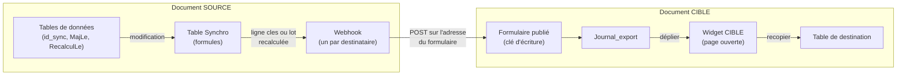
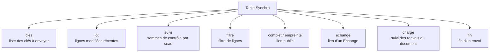
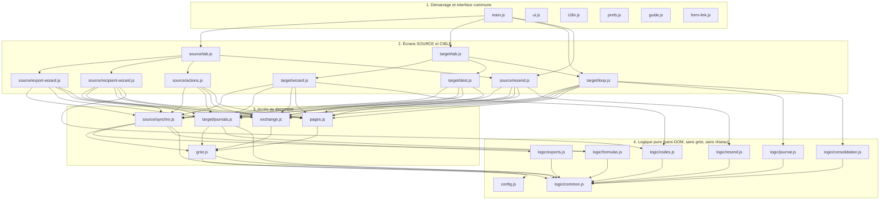
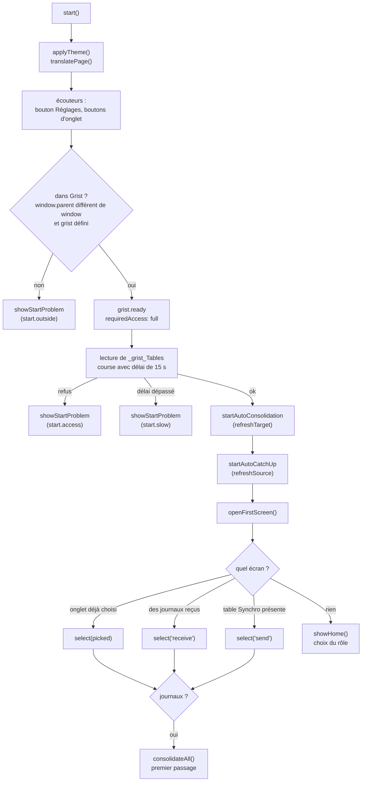
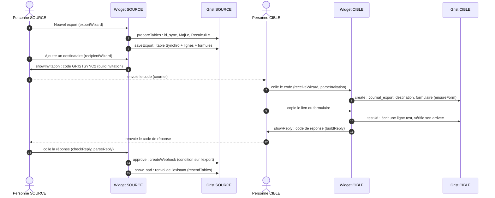
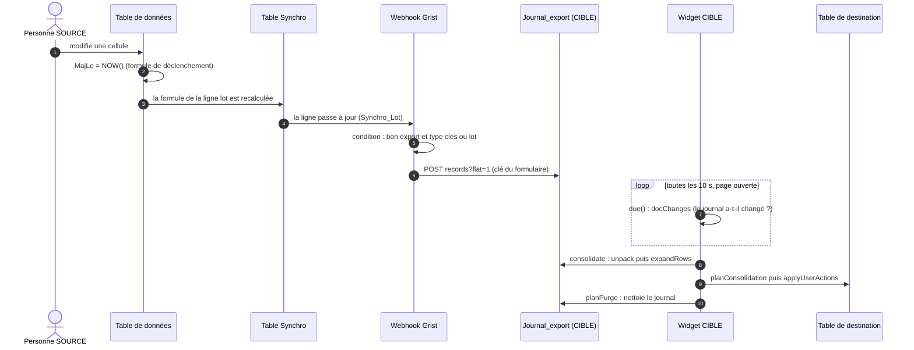
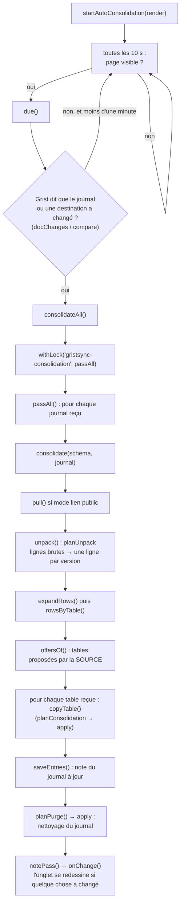
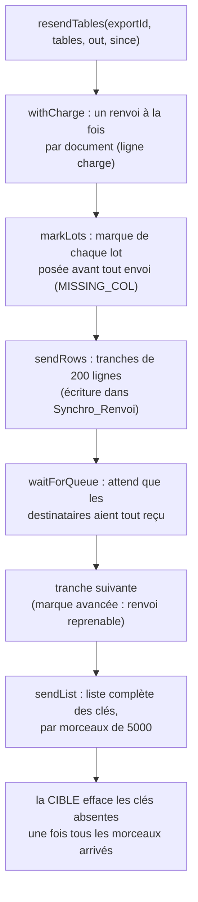

# Mécanisme de SyncPlus (version « Constructeur »)

Ce document explique en détail comment fonctionne le widget **SyncPlus** (Grist Factory, version 0.5.9, GNU GPL v3.0) tel qu'il a été adapté pour le widget personnalisé « Constructeur » de Grist : le code HTML, l'enchaînement des fichiers et des fonctions, et le rôle des principales variables.

> Les schémas sont écrits en [Mermaid](https://mermaid.js.org/) : ils s'affichent dans GitLab, GitHub, VS Code (avec l'extension Markdown Mermaid) et dans la plupart des visionneuses Markdown.

---

## Sommaire

1. [Principe général](#1-principe-général)
2. [Vocabulaire et tables techniques](#2-vocabulaire-et-tables-techniques)
3. [Le code HTML](#3-le-code-html)
4. [Architecture du JavaScript](#4-architecture-du-javascript)
5. [Le démarrage (`main.js`)](#5-le-démarrage-mainjs)
6. [Les modules un par un](#6-les-modules-un-par-un)
7. [Variables et constantes](#7-variables-et-constantes)
8. [Les enchaînements de bout en bout](#8-les-enchaînements-de-bout-en-bout)
9. [Mécanismes fins](#9-mécanismes-fins)
10. [Sécurité](#10-sécurité)
11. [Ce qui change dans la version « Constructeur »](#11-ce-qui-change-dans-la-version--constructeur-)
12. [Index des fonctions clés](#12-index-des-fonctions-clés)

---

## 1. Principe général

SyncPlus recopie des tables d'un document Grist vers un autre, **sans serveur tiers**. Le même code est installé dans les deux documents ; le rôle de chacun dépend de ce qu'il contient :

- **SOURCE** (onglet **Envoyer**) : le document qui possède les données. Il prépare un **export** (tables, colonnes, filtre) et déclare un **webhook** par destinataire.
- **CIBLE** (onglet **Recevoir**) : le document qui reçoit. Il publie un **formulaire**, dont l'adresse d'écriture sert de destination au webhook, puis recopie ce qui arrive dans une **table de destination**.

Tout passe par trois canaux fournis par Grist :

| Canal | Rôle |
|---|---|
| API des widgets (`grist.docApi`) | lire les tables, appliquer des actions groupées (`applyUserActions`) |
| API REST du document (jeton `getAccessToken`) | webhooks, requêtes SQL légères, comparaison d'états (`/compare`) |
| Formulaire publié de la CIBLE | adresse d'écriture que le webhook de la SOURCE appelle |



Points clés :

- La SOURCE **ne contacte jamais directement** la table de destination : elle écrit seulement dans le **journal** de la CIBLE, par la clé du formulaire.
- Ce sont des **formules** dans la table `Synchro` (côté SOURCE) qui calculent ce qui doit partir. Grist envoie la ligne au webhook quand son contenu change.
- Le **widget de la CIBLE** (page ouverte) déplie le journal et applique les changements. Sans page ouverte côté CIBLE, rien n'est recopié (voir §9).

---

## 2. Vocabulaire et tables techniques

| Terme | Signification |
|---|---|
| **Export** | un ensemble de tables (avec colonnes et filtre de lignes) identifié par un identifiant hexadécimal de 16 caractères |
| **Destinataire** | une personne ou un document qui reçoit un export (un webhook sur la SOURCE) |
| **Invitation** | code à transmettre à la CIBLE (`GRISTSYNC2.…`) ; contient l'export, ses tables, ses colonnes |
| **Réponse** | code renvoyé par la CIBLE ; contient l'adresse d'écriture du journal |
| **Journal** | table `Journal_<export>` de la CIBLE, où le webhook dépose les lignes |
| **Destination** | table de la CIBLE qui reçoit réellement les données |
| **Lot** | lignes modifiées dans les 5 dernières secondes, avec leurs colonnes |
| **Liste des clés** | information servant à détecter les suppressions |
| **Échange** | mode où deux documents se tiennent à jour mutuellement |
| **Lien public** | mode sans webhook : la CIBLE lit elle-même des instantanés |

### Tables ajoutées par le widget

**Côté SOURCE** : une seule table technique, `Synchro`, quel que soit le nombre d'exports. Chaque table d'un export y a plusieurs lignes, distinguées par la colonne `Synchro_Type` :



Seules les lignes `cles` et `lot` sont envoyées par les webhooks (voir la condition au §6.4).

**Côté CIBLE** : un journal par export reçu, nommé `Journal_<identifiant de l'export>`, plus les tables de destination.

**Colonnes ajoutées aux tables envoyées** (côté SOURCE) :

| Colonne | Rôle |
|---|---|
| `id_sync` | clé stable de la ligne (UUID posé à la création) |
| `MajLe` | heure de la dernière modification d'une valeur envoyée (déclenchée par formule) |
| `RecalculLe` | heure du dernier recalcul de `MajLe` (sert à repérer une annulation Ctrl+Z) |
| `Supprime` | suppression logique (surtout en mode Échange) |

---

## 3. Le code HTML

Le HTML de la version « Constructeur » se compose de trois blocs, collés dans l'onglet **HTML** du widget :

```html
<style> … toute la feuille de style … </style>
<template id="grist-theme"></template>
<header class="topbar"> … </header>
<main id="main"></main>
```

### 3.1 Les éléments

| Élément | Rôle |
|---|---|
| `<style>` | charte graphique : variables CSS (`--bg`, `--accent`, `--danger`…), thème clair, thème sombre (`@media prefers-color-scheme` et attribut `data-theme`), composants (`.btn`, `.card`, `.tile`, `.pill`, `.msg`, fenêtres, listes, tableaux) |
| `<template id="grist-theme">` | élément inerte qui absorbe le texte que l'API des widgets écrit dans `#grist-theme` (sans lui, l'API créerait une balise `<style>` interdite par une CSP stricte) |
| `<header class="topbar">` | barre du haut |
| `<h1 class="brand" data-i18n="app.title">` | titre « Synchro », traduit au démarrage |
| `<nav id="tabs">` | les deux onglets, des boutons `data-tab="send"` et `data-tab="receive"` |
| `<button id="settings">` | ouvre la fenêtre des Réglages (langue, thème, crédits) |
| `<main id="main">` | **zone unique** où le JavaScript dessine tout : accueil, onglets, messages d'erreur |

### 3.2 Les attributs qui font le lien avec le JavaScript

- `id="main"` : cible de `showScreen()`, qui fait `replaceChildren` sur cet élément.
- `id="settings"` : reçoit l'écouteur `click` qui appelle `openSettings()`.
- `data-tab` (`send` / `receive`) : lu par `main.js` pour griser les boutons, marquer l'onglet actif (`aria-selected`) et mémoriser le choix (`picked`).
- `data-i18n="clé"` : `translatePage()` remplace le texte par `t(clé)`.
- `data-i18n-label="clé"` : `translatePage()` renseigne `aria-label` et `title` (infobulle).

### 3.3 Principe de rendu

Le HTML est **volontairement minimal** : tout le reste (cartes, assistants, fenêtres) est construit en JavaScript avec la fonction `el()` de `ui.js`, **sans `innerHTML`**. Aucun texte venant du document ou d'un code collé n'est interprété comme du HTML (protection contre l'injection).

Le thème se règle ainsi : `applyTheme()` lit la préférence `gristsync.theme` ; si elle vaut `light` ou `dark`, elle écrit `document.documentElement.dataset.theme`, sinon elle retire l'attribut et le thème suit le système.

---

## 4. Architecture du JavaScript

Le code d'origine comptait une trentaine de fichiers `.js` en modules ES. La version « Constructeur » les regroupe dans un seul script, mais **l'architecture logique reste la même**. Elle se lit en quatre couches :



**Règle de conception** (écrite en tête de `logic/common.js`) : tout ce qui *décide* (quelle version gagne, quoi écrire, quelle adresse accepter) vit dans `logic/`. Les autres modules lisent Grist, appellent ces fonctions, puis appliquent le résultat. C'est ce qui rend la logique testable sans navigateur.

---

## 5. Le démarrage (`main.js`)

`main.js` est exécuté en dernier. Sa fonction `start()` enchaîne :



**Choix du premier écran** (`openFirstScreen`) : le widget regarde ce que le document contient déjà (`readSchema`, `receivedJournals`, `readSourceNote`, `legacyJournals`) et ouvre l'onglet du rôle déjà tenu ; sinon l'accueil propose « Envoyer » ou « Recevoir ».

**Fonctions de `main.js`**

| Fonction | Rôle |
|---|---|
| `$(id)` | raccourci pour `document.getElementById` |
| `showScreen(...nodes)` | remplace le contenu de `#main` |
| `showStartProblem(text, {reload})` | écran d'erreur de démarrage (onglets grisés, bouton « Recharger ») |
| `select(tab)` | active un onglet et appelle `renderSource` ou `renderTarget` |
| `showHome()` | accueil avec les deux tuiles et le mode d'emploi |
| `openSettings()` | fenêtre des Réglages (langue, thème, crédits : Grist Factory, GNU GPL v3.0, version) |
| `start()` | séquence de démarrage ci-dessus |
| `openFirstScreen()` | choisit le premier écran |

---

## 6. Les modules un par un

### 6.1 Socle commun

**`config.js`** : le seul réglage du widget.

- `GRIST_ORIGINS` : liste des instances Grist que le widget a le droit d'appeler. Toute requête réseau y est comparée (`gristFetch`).
- `VERSION` : texte affiché dans les Réglages.

**`prefs.js`** : préférences dans le `localStorage` (préfixe `gristsync.`), jamais de données du document.

- `readPref(name)` / `writePref(name, value)` : lecture/écriture protégées par `try/catch` (stockage refusé : retourne `null` / `false`).
- `applyTheme()` : pose ou retire `data-theme`.

**`i18n.js`** : traductions.

- `fr`, `en` : objets de textes (clé → phrase). Les pluriels s'écrivent `{n|singulier|pluriel}`.
- `LANG` : langue choisie (préférence, sinon langue du navigateur).
- `format(lang, key, vars)` / `t(key, vars)` : texte traduit avec variables ; clé absente → texte français, puis la clé elle-même.
- `dateText`, `timeText`, `typeName` : dates et types de colonne « en clair ».
- `translatePage()` : applique `data-i18n` et `data-i18n-label`.

**`ui.js`** : briques d'interface.

- `el(tag, attrs, ...children)` : crée un élément (texte via `textContent`, enfants aplatis).
- `message(kind, text)`, `icon(name)` : bandeaux et pictogrammes.
- `openModal({title, body, buttons, width, onClose})` : fenêtre avec gestion du focus (Tab circulaire, Échap).
- `openWizard({title, steps, onClose})` : assistant à étapes numérotées (`show`, `buttons`, `setSteps`, `close`).
- `confirmDialog`, `copyField`, `copyButton` : confirmation, champ de code en lecture seule, bouton « Copier » (si le presse-papiers est refusé, `onFail` sélectionne le texte).
- `checkList`, `pickField` : listes à cocher / de choix, filtrables sans accents ni majuscules.
- `errorText(e)` : transforme une erreur en phrase lisible (clé `error.<message>` sinon message générique).
- `run(button, out, fn)` : exécute une action, grise le bouton, affiche l'erreur.

**`guide.js`** : mode d'emploi à deux rôles.

- `STEPS` : étapes de chaque mode (réponse, lien public, Échange).
- `roleGuide({you, mode, current, open})` : bloc d'aide « qui fait quoi ».
- `handoffText(role, mode, from, code)` : texte de consignes à transmettre avec un code.

**`form-link.js`** : lien du formulaire de réception.

- `formWhere(journal)` : retrouve le formulaire d'un journal.
- `linkFigures()` : les deux consignes pour copier le lien (texte seul dans cette version).
- `testUrl(url, journal)` : écrit une ligne marquée d'un nombre aléatoire par la clé du formulaire, et vérifie qu'elle arrive bien dans **ce** journal (valide d'un coup la clé, la publication, le nom de table et `?flat=1`).

### 6.2 Accès à Grist (`grist.js`)

| Fonction | Rôle |
|---|---|
| `gristFetch(url, options)` | **seul point de sortie réseau** : refuse toute adresse hors `GRIST_ORIGINS` (erreur `otherInstance`), sans cookies (`credentials: 'omit'`) |
| `fetchRows(tableId)` | lit une table (`fetchTable`) et la convertit en lignes |
| `apply(actions)` | applique des actions groupées (`applyUserActions`), rien si la liste est vide |
| `readSchema()` | instantané des tables et colonnes (`_grist_Tables`, `_grist_Tables_column`) avec les méthodes `has`, `table`, `resolve`, `tableIdOf`, `columns` |
| `docIdentity()` | instance, équipe, identifiant du document (déduits de `baseUrl`) |
| `isReadOnly()` | lit le paramètre `readonly` de l'adresse du widget |
| `isOwner()` | vrai si la liste des webhooks est lisible (propriétaire) |
| `selectRows(tableId, colIds)` | lecture SQL légère par l'API REST |
| `docChanges(since)` | tables changées depuis un état (`/compare`) |
| `withLock(name, fn)` | une seule exécution à la fois, tous onglets confondus (`navigator.locks`) |
| `rest(method, path, body)` | appel REST authentifié par jeton (`auth=`), en-têtes CSRF |
| `listWebhooks`, `createWebhook`, `webhookConditions`, `setWebhookEnabled`, `renameWebhook`, `deleteWebhook`, `deleteWebhookWithNotice`, `clearWebhookQueue` | gestion des webhooks |

### 6.3 Logique pure (`logic/`)

**`logic/common.js`** : noms partagés et utilitaires (voir §7 pour les constantes) : `toRows`, `chunk`, `groupBy`, `isBlank`, `isTrue`, `parseJson`, `randomHex`, `sha256`, `isSafeId`, `toTableId`, `freeTableId`, `crc32`, `bucketOf`.

**`logic/codes.js`** : codes d'invitation et de réponse, adresses.

- `buildInvitation`, `parseInvitation`, `buildReply`, `parseReply`, `decodeCode` : fabriquent et valident les codes (`GRISTSYNC2.` + JSON en base64url).
- `validColumns`, `exportSchema` : contrôle des colonnes décrites dans un code.
- `parseFormLink`, `buildWebhookUrl`, `parseWebhookUrl` : adresses des formulaires et des webhooks.
- `parseDocBaseUrl`, `loopingTables`, `maskKey` : identité du document, refus des boucles, masquage des clés dans les messages.

**`logic/formulas.js`** : formules Python de la table `Synchro` et colonnes ajoutées.

- `syncFormulas(tables)`, `syncColumns(tables)` : formules et colonnes de `Synchro`.
- Trois formules principales (`keysFormula`, `lotFormula`, `stateFormula`) : liste des clés, lot, suivi.
- `prepareSourceActions`, `majleAction`, `keyTriggerAction`, `fillKeyActions`, `deleteColumnAction`, `missingSyncColumns` : préparation des tables envoyées.

**`logic/exports.js`** : exports et destinataires.

- `exportableColumns`, `rowFilter` : colonnes envoyables, filtre de lignes.
- `exportRowsActions`, `exportTables`, `swapExports` : lignes `Synchro` d'un export.
- `exportCondition(exportId)`, `conditionExport(text)`, `hookName`, `hooksOf` : condition de webhook, noms, destinataires d'un export.
- `exchangeTables`, `exchangeColumns` : correspondance des colonnes en mode Échange.
- `publicAclRules`, `publicAclActions` : règles d'accès du lien public.
- `endNotice(exportId)` : ligne « fin » envoyée à un destinataire coupé.

**`logic/journal.js`** : lecture du journal côté CIBLE.

- `parseList`, `parseLot` : lisent une liste de clés ou un lot reçu.
- `planUnpack` : déplie les lignes brutes (une ligne par version).
- `latestByKey`, `expandRows`, `rowsByTable`, `compareOrder`, `compareVersion` : dernière version de chaque clé.
- `planPurge` : nettoyage du journal.
- `recentChanges`, `planPull` : historique et lien public.

**`logic/consolidation.js`** : recopie dans la destination.

- `planConsolidation(...)` : calcule les actions Grist qui amènent la destination à l'état de la SOURCE.
- `copyColumns`, `followRenames`, `newColumnsMap`, `droppedColumns`, `destRefs` : correspondance des colonnes.
- `manualEdits`, `restoreActions`, `rowNumbers` : retouches manuelles et bouton « Corriger ».

**`logic/resend.js`** : renvois ménagés.

- `RESEND_CHUNK`, `resendValue`, `rowsSince`, `chunkMark`, `listRequest`, `trackState`, `listDue` : tranches de renvoi.
- `parseCharge`, `chargeBusy`, `addSpent`, `budgetWait` : un renvoi à la fois par document et budget d'octets par fenêtre de temps.

### 6.4 SOURCE

**`source/synchro.js`** : gère la table `Synchro`.

- `syncRows`, `chargeRow`, `isCharge` : lecture des lignes.
- `readSourceNote`, `updateSourceNote` : note JSON (exports, invitations, pauses) stockée dans la description de la colonne `Synchro_Export`.
- `ensureSyncTable(rows)` : crée ou met à niveau `Synchro` (colonnes, formules, dépendances).
- `refreshMajLe()` : met à jour la formule de déclenchement de `MajLe` des tables envoyées.
- `saveExport(exportId, tables, options)`, `removeExport(exportId)` : enregistrent ou effacent un export.
- `writeSync(ids, fields)` : écrit des champs dans des lignes de `Synchro`.

**`source/tab.js`** : onglet « Envoyer ».

- `renderSource(root)` / `refreshSource()` : dessinent l'onglet (une carte par export).
- `loadState()`, `exportState()` : lisent exports, destinataires (webhooks), invitations.
- `drift()` : signale tables ou colonnes changées depuis l'enregistrement.
- `syncPublicRules()` : règles d'accès du lien public.
- `exportCard`, `personRow`, `inviteRow`, `publicRow`, `cleanupCard` : cartes de l'interface.

**`source/export-wizard.js`** : assistant d'export en trois étapes.

1. `showTables` : choix des tables.
2. `showColumns` / `columnsBlock` : colonnes et filtre de lignes.
3. `showName` : nom, puis `save()`.

`prepareTables` ajoute `id_sync`, `MajLe`, `RecalculLe` aux tables et pose les clés ; `save` appelle `saveExport` puis, en modification, `resendTables` pour les tables changées.

**`source/recipient-wizard.js`** : assistant d'ajout d'un destinataire, en quatre étapes (`STEP = { options, invitation, reply, load }`).

- `showOptions` : mode (réponse, lien public, Échange) et secret.
- `invite`, `showInvitation` : fabrique et affiche le code d'invitation.
- `showReply`, `checkReply`, `replyFiche` : lit et contrôle la réponse.
- `approve` : crée le webhook (`createWebhook`).
- `showLoad` : propose d'envoyer l'existant.

**`source/actions.js`** : `pause`, `resume`, `revoke`, `cancelInvitation`, `unblockQueue`, `deleteExport`, `publicCode`, `showPublicCode`, `stopPublic`, `handoff`.

**`source/resend.js`** : renvois et rattrapage automatique.

- `resendTables(exportId, tables, out, since)` : renvoie des lignes par tranches, puis la liste complète des clés.
- `sendRows`, `sendList`, `markLots`, `waitForQueue`, `clearAndMark`, `hookStatus` : étapes d'un renvoi.
- `startAutoCatchUp(render)` : rattrapage toutes les 10 secondes tant qu'un propriétaire a la page ouverte (voir §9.6).

### 6.5 CIBLE

**`target/journals.js`** : un journal par export reçu.

- `JOURNAL_COLUMNS` : colonnes du journal.
- `receivedJournals(schema)`, `legacyJournals`, `receivedDests` : journaux et destinations connus.
- `createJournal`, `prepareDest`, `upgradeJournal`, `addDestColumnsActions`, `destColumns` : création et mise à niveau.
- `readNote`, `writeNote`, `updateJournalNote` : note JSON stockée dans la description de la colonne `Synchro_Ids`.

**`target/wizard.js`** : assistant de réception en quatre étapes (`STEP = { code, dest, link, reply }`).

- `showCode`, `readInvitation` : lit et contrôle l'invitation.
- `showDest`, `showColumns` : destination de chaque table, correspondance des colonnes.
- `create` : crée le journal et les destinations.
- `showLink` : lien du formulaire, vérifié par `testUrl`.
- `showReply` : code de réponse à renvoyer à la SOURCE.

**`target/dest.js`** : `destField`, `mappingBlock`, `checkDests`, `offerDialog` (table ajoutée plus tard par la SOURCE).

**`target/tab.js`** : onglet « Recevoir » : `renderTarget`, `refreshTarget`, `syncCard`, `tableLine`, `cardNotes`, `suspectBlock`, `cutLink`, `stopReceiving`, `driftBlock`, `correct`, historique des changements.

**`target/loop.js`** : la boucle de recopie (voir §8.4).

- `startAutoConsolidation(render)`, `due()`, `consolidateAll()`, `passAll()`, `consolidate()`, `pull()`, `unpack()`, `copyTable()`, `restoreSource()`.

### 6.6 Transversaux

**`pages.js`** : `ensureForm(tableId)` (publie un formulaire sur sa propre page), `formPages`, `renewFormLink`, `removeTechnicalTables`, `dropPages`, `hideColumn`.

**`exchange.js`** : mode Échange : `wireExchange`, `addDeleteColumns`, `endExchange`.

---

## 7. Variables et constantes

### 7.1 Colonnes techniques (`logic/common.js`)

| Constante | Valeur | Rôle |
|---|---|---|
| `KEY_COL` | `id_sync` | clé stable de la ligne (UUID) |
| `ORDER_COL` | `MajLe` | heure de la dernière modification d'une valeur envoyée |
| `RECALC_COL` | `RecalculLe` | heure du dernier recalcul de `MajLe` |
| `DELETE_COL` | `Supprime` | suppression logique |
| `SYNC_TABLE` | `Synchro` | table technique de la SOURCE |
| `EXPORT_COL` | `Synchro_Export` | identifiant de l'export |
| `TABLE_COL` | `Synchro_Table` | table SOURCE d'origine |
| `TYPE_COL` | `Synchro_Type` | type de ligne (voir `KIND`) |
| `SCHEMA_COL` | `Synchro_Colonnes` | colonnes envoyées, en JSON |
| `RESEND_COL` | `Synchro_Renvoi` | lignes à renvoyer (écrit par le widget) |
| `LIST_COL` | `Synchro_Ids` | liste des clés à envoyer |
| `LOT_COL` | `Synchro_Lot` | lot de lignes avec leurs colonnes, en JSON |
| `AUTHOR_COL` | `Sync_Par` | e-mail de la personne qui a ajouté la ligne |
| `STATE_COL` | `Sync_Etat` | effet de la version recopiée (ajout, modif, suppression) ; sert aussi de colonne de suivi et de marque d'envoi coupé |
| `APPLIED_COL` | `Sync_Applique` | version déjà recopiée dans la destination |
| `RECEIVED_COL` | `Sync_Recu` | date d'arrivée de la ligne dans le journal |
| `DATA_COL` | `Synchro_Donnees` | colonnes d'une ligne dépliée, en bloc JSON |
| `BEFORE_COL` | `Sync_Avant` | ce que la recopie a remplacé (historique) |
| `JOURNAL_PREFIX` | `Journal_` | préfixe des journaux de la CIBLE |

`MISSING_COL` et `TRACK_COL` reprennent `STATE_COL` : le webhook envoie la ligne `Synchro` entière, et un journal refuse une colonne qu'il n'a pas ; ces rôles réutilisent donc une colonne que tous les journaux possèdent.

### 7.2 Types de ligne `KIND`

| Clé | Valeur | Contenu |
|---|---|---|
| `keys` | `cles` | liste des clés (envoyée par webhook) |
| `lot` | `lot` | lot de lignes modifiées (envoyé par webhook) |
| `full` | `complet` | instantané complet (lien public) |
| `mark` | `empreinte` | taille et CRC-32 de l'instantané public |
| `filter` | `filtre` | filtre de lignes de la table |
| `track` | `suivi` | suivi des clés (sommes CRC-32 par seau) |
| `swap` | `echange` | ligne d'un export en Échange |
| `load` | `charge` | suivi des renvois du document (une seule) |
| `end` | `fin` | fin d'un envoi (destinataire coupé) |

### 7.3 Paramètres de fonctionnement

| Constante | Valeur | Module | Rôle |
|---|---|---|---|
| `BUCKETS` | 256 | common | nombre de « seaux » où sont réparties les clés |
| `CHUNK` | 500 | common | lignes par action groupée |
| `WINDOW_S` | 5 s | formulas | un lot porte les lignes modifiées depuis 5 secondes |
| `SMALL_TABLE` | 20 | formulas | taille en dessous de laquelle une table est renvoyée en entier après un recalcul global |
| `LOT_MAX` / `POST_MAX` / `LOT_MIN` | 250 000 / 950 000 / 20 000 octets | formulas | taille d'un lot ; Grist refuse un envoi de plus de 1 Mo |
| `PUBLIC_MAX` | 2 000 000 octets | formulas | taille maximale d'un instantané de lien public |
| `PART_KEYS` | 5000 | formulas | au-delà, la liste complète des clés est renvoyée par morceaux |
| `RESEND_CHUNK` | 200 | logic/resend | lignes par tranche de renvoi |
| `RESEND_BUDGET` | 20 000 000 octets | logic/resend | budget d'envois de renvoi par fenêtre |
| `BUDGET_WINDOW` | 600 s | logic/resend | durée de cette fenêtre |
| `LEASE_S` | 120 s | logic/resend | au-delà de ce délai sans signe de vie, une autre page peut reprendre un renvoi |
| `POLL_MS` | 10 000 ms | target/loop | rythme du coup d'œil de la CIBLE |
| `IDLE_MS` | 60 000 ms | target/loop | rythme au repos (rien n'arrive) |
| `REREAD_MS` | 300 000 ms | target/loop | relecture complète d'une destination, au plus tard |
| `RAW_BATCH` | 500 | target/loop | lignes reçues dépliées par passage |
| `FLOOD_PER_MIN` | 600 | target/loop | au-delà, l'arrivée est jugée anormale |
| `DRIFT_KEPT` | 20 | target/loop | retouches manuelles gardées pour la carte |
| `MAX_COLUMNS` | 400 | codes | colonnes par table dans un code |
| `MAX_LINES`, `MAX_BIG`, `MAX_TABLES` | 100 000, 1000, 200 | journal | bornes de lecture d'un journal |

### 7.4 État en mémoire (n'existe que pendant que la page est ouverte)

**`target/loop.js`**

| Variable | Rôle |
|---|---|
| `state` | ce que l'onglet « Recevoir » affiche : `results` (dernier passage par journal et par table), `offers` (tables proposées), `readOnly`, `viewer`, `lastVisit` |
| `busy` | un passage est en cours (évite deux passages simultanés) |
| `lastArrival`, `lastPass` | dernière arrivée dans un journal, début du dernier passage (règlent le rythme) |
| `watch` | coup d'œil sur le document : `hash` (état précédent), `tables` (journaux et destinations suivis), `pull` (un journal en lien public), `compare` (faux si Grist refuse `/compare`) |
| `onChange` | fonction qui redessine l'onglet (donnée par `startAutoConsolidation`) |
| `inflow` | lignes reçues vues au passage précédent (détection de flot anormal) |
| `settled` | journaux déjà recopiés sans effet (évite de refaire un travail inutile) |
| `lastRead` | numéros de ligne et retouches à la dernière lecture |
| `pulled` | empreintes des instantanés publics déjà lus |

**`source/tab.js`** : `container` (zone de l'onglet), `notice` (message au prochain affichage), `resumed` (l'assistant d'Échange ne se rouvre qu'une fois).

**`target/tab.js`** : `wizardOpened`, `offered` (tables déjà proposées), `opened` (historiques dépliés).

**`source/resend.js`** : `catching` (rattrapage en cours), `notOwner`, `repairedAt` (dernier déblocage de la file).

**`main.js`** : `picked` (onglet choisi pendant le démarrage), `ready` (démarrage terminé).

**`ui.js`** : `stack` (pile des fenêtres ouvertes).

### 7.5 Données conservées **dans** les documents (pas dans le navigateur)

| Où | Contenu |
|---|---|
| Description de la colonne `Synchro_Export` (SOURCE) | note JSON : exports (nom, date, public), invitations en attente (avec l'**empreinte** du secret, jamais le secret), pauses |
| Description de la colonne `Synchro_Ids` d'un journal (CIBLE) | note JSON : export, nom, secret, origine, mode, tables (table reçue, destination, colonnes, correspondance, rattachement), tables refusées, lignes manquantes, arrivées suspectes |
| Table `Synchro` | lignes `cles`, `lot`, `suivi`, `filtre`, `complet`, `empreinte`, `echange`, `charge` |
| `_grist_Triggers` | webhooks et leur condition |

### 7.6 Préférences du navigateur (`localStorage`, préfixe `gristsync.`)

| Clé | Contenu |
|---|---|
| `lang` | langue (`fr` ou `en`) |
| `theme` | `system`, `light` ou `dark` |
| `visit.<docId>` | date de la dernière visite d'un document CIBLE (pour l'historique) |
| `browser` | identifiant aléatoire de ce navigateur (voir `chargeBusy`) |

---

## 8. Les enchaînements de bout en bout

### 8.1 Création d'un export et d'un destinataire (SOURCE ↔ CIBLE)



Contrôles faits en chemin :

- `parseInvitation` / `parseReply` : tous les identifiants, colonnes et adresses sont **revalidés** et réécrits à partir de leurs seuls éléments reconnus.
- `parseReply` vérifie que l'adresse d'écriture est sur **la même instance** que la SOURCE (sinon `otherInstance`) et que le secret correspond (comparé par empreinte).
- `loopingTables` refuse qu'une table soit renvoyée vers le document d'où elle vient.

### 8.2 Une modification dans la SOURCE



### 8.3 Ce que calcule la SOURCE : les trois formules de `Synchro`

| Formule | Colonne | Ce qu'elle produit |
|---|---|---|
| `lotFormula` | `Synchro_Lot` | lignes modifiées depuis 5 s (et celles demandées dans `Synchro_Renvoi`), avec les colonnes de l'export, plafonnées en taille ; ligne annulée (Ctrl+Z) envoyée avec l'heure de l'annulation |
| `keysFormula` | `Synchro_Ids` | ce qu'il faut envoyer de la liste des clés : seaux ayant perdu une clé, ou morceau de la liste complète pendant un renvoi |
| `stateFormula` | `Sync_Etat` | suivi : nombre de clés et somme des CRC-32 par seau, qui déclenche l'envoi de la liste ; marque d'un envoi coupé |

Ces formules **nomment en clair** les tables qu'elles lisent : le widget les réécrit (`refreshFormulas`) quand un export gagne ou perd une table.

### 8.4 La boucle de recopie de la CIBLE (`target/loop.js`)



À retenir :

- **Un passage par journal, étape par étape**, chaque étape étant **un seul lot d'écritures** (tout ou rien).
- Le passage est protégé par `withLock` : deux onglets du même navigateur ne recopient pas en même temps. Entre navigateurs, les écritures sont **idempotentes** (rejouer le plan ne change rien).
- Rythme : au plus toutes les 10 s tant que des lignes arrivent, puis toutes les minutes (`IDLE_MS`). Le retour sur la page (`visibilitychange`) force un passage avec relecture complète.
- `due()` s'appuie sur `docChanges` (comparaison d'états, quelques millisecondes) ; si Grist refuse (droits), `watch.compare` passe à faux et le rythme redevient fixe.

### 8.5 Que fait `planConsolidation` ?

Pour une table, à partir des lignes du journal et de celles de la destination :

1. Prend la **dernière version** de chaque clé (`latestByKey`, ordre : `MajLe`, puis numéro de ligne du journal).
2. Décide pour chaque clé son effet : `ajout`, `modif`, `suppression`, ou rien (`versionState`, `withoutEffect`).
3. Détermine les **clés parties** de la SOURCE d'après les listes pas encore traitées (`droppedKeys`).
4. Rattache éventuellement une ligne existante sans clé de même valeur dans la colonne de rattachement (`matchCol`).
5. Produit les actions Grist : ajouts et modifications, suppressions, marques `Sync_Applique` / `Sync_Etat`, et ce qui est remplacé (`Sync_Avant`).

Une **retouche manuelle** dans la destination survit donc jusqu'à la prochaine modification côté SOURCE de la même ligne ; `manualEdits` les repère et le bouton « Corriger » (`restoreSource`) rétablit l'état exact de la SOURCE.

### 8.6 Renvoi et rattrapage (SOURCE)

Quand un destinataire est branché, ou après une pause, un envoi coupé ou une file bloquée, le widget SOURCE **renvoie** des lignes :



- Le widget **ne modifie pas les tables** : il écrit les lignes voulues dans `Synchro_Renvoi`, et Grist recalcule le lot.
- Un budget de 20 Mo par fenêtre de 10 minutes (`addSpent`, `budgetWait`) ménage l'instance.
- `startAutoCatchUp` surveille, toutes les 10 secondes (une minute si l'onglet est caché), les lots marqués, les envois refusés pour leur taille (413 : la file est vidée, `clearAndMark`) et reprend ce qui est resté en suspens.

### 8.7 Autres modes

- **Lien public** : pas de webhook ni de réponse. L'export publie des lignes `complet` et `empreinte` ; des règles d'accès (`publicAclRules`) n'exposent que celles-là aux lecteurs. La CIBLE les lit (`pull` → `planPull`) et ne relit un instantané que si son empreinte a changé.
- **Échange** : deux documents se tiennent à jour. Chacun a un export et un journal en mode `echange`. Les tables reçoivent la colonne `Supprime`. La **version la plus récente gagne** (`MajLe` comparée) et une ligne reçue n'est pas renvoyée à son auteur (pas d'écho).

---

## 9. Mécanismes fins

### 9.1 Quelle version gagne ?

Chaque ligne envoyée porte `MajLe`. En cas de conflit, la version dont `MajLe` est la plus récente l'emporte ; à égalité, la dernière ligne arrivée dans le journal (`compareOrder`, `compareVersion`).

### 9.2 Détecter les suppressions : les « seaux »

Un webhook n'annonce pas les suppressions de ligne. Le widget contourne ce manque :

- chaque clé est rangée dans l'un des **256 seaux** selon son CRC-32 (`bucketOf`) ;
- la ligne `suivi` garde, par seau, une **somme de CRC-32** (quelques Ko, de taille fixe quelle que soit la table) ;
- quand une somme bouge autrement que par des clés nouvelles, le seau a **perdu une clé** : la ligne `cles` envoie la liste des clés **restantes** de ce seau ;
- la CIBLE compare avec ses lignes et **efface celles qui ne figurent plus** dans la liste la plus récente (`droppedKeys`).

Au-delà de 5000 clés à envoyer d'un coup, le widget SOURCE renvoie la liste complète, par morceaux.

### 9.3 Les annulations (Ctrl+Z)

Une annulation remet `MajLe` à sa valeur d'avant, mais Grist recalcule `RecalculLe`. La formule du lot compare les deux : la ligne repart alors avec **l'heure de l'annulation**, pour l'emporter sur la version qu'elle annule.

### 9.4 Taille et limites

Grist refuse un envoi de plus de 1 Mo. Un lot est plafonné à 250 000 octets, la part laissée aux listes de clés est calculée (`LOT_MAX`, `POST_MAX`, `LOT_MIN`). Un lot coupé est marqué et le widget SOURCE envoie le reste.

### 9.5 Le journal est une zone non fiable

Le lien du formulaire permet d'écrire n'importe quoi dans le journal. Le widget CIBLE traite donc chaque ligne brute avec méfiance (`readRaw`) : une ligne qui ne peut pas venir du webhook de cet export est effacée sans effet et **comptée** (arrivées suspectes). Si plus de 600 lignes arrivent par minute, la carte signale un flot anormal et propose de **couper le lien** (`cutLink`, qui renouvelle la clé du formulaire).

### 9.6 Pourquoi la CIBLE doit avoir une page ouverte

La recopie est faite **par le widget**, dans le navigateur d'une personne qui a le document ouvert. Pas de serveur : si personne n'ouvre la CIBLE, le journal se remplit mais rien n'est recopié, jusqu'à la prochaine ouverture. De même, le rattrapage de la SOURCE (`startAutoCatchUp`) ne tourne que tant qu'un propriétaire a la page ouverte.

---

## 10. Sécurité

| Mesure | Où |
|---|---|
| Aucune requête réseau hors `GRIST_ORIGINS`, sans cookies | `gristFetch` |
| Jeton d'accès court passé en paramètre `auth=` | `rest`, `selectRows`, `docChanges` |
| Rien n'est interprété comme du HTML | `el()` (jamais `innerHTML`) |
| Identifiants validés (`COL_ID`, `HEX16`) et noms propres aux objets JavaScript refusés (`__proto__`, `constructor`) | `isSafeId`, `is()` |
| Codes d'invitation et de réponse revalidés, adresses réécrites | `parseInvitation`, `parseReply`, `parseWebhookUrl` |
| Webhook limité à la même instance, à une adresse d'écriture par clé de formulaire | `parseReply` |
| Secret facultatif : seule son **empreinte** (SHA-256) est conservée côté SOURCE | `sha256`, note de la SOURCE |
| Clés de partage jamais affichées en entier, même dans un message d'erreur de Grist | `maskKey` |
| Condition de webhook contrôlée : un webhook sans filtre reconnu est signalé (il recevrait tous les exports) | `conditionExport`, `unsafeCard` |
| Droits : seules les personnes propriétaires gèrent les webhooks (403 sinon, `ownerOnly`) | `rest` |
| Boucles refusées à l'approbation | `loopingTables` |
| Lien public : règles d'accès limitant les lecteurs aux lignes `complet` et `empreinte` de l'export | `publicAclRules` |

**Attention (rappel)** : le widget demande l'**accès complet** au document, et le lien du formulaire de réception est un **droit d'écriture** dans le journal. À ne pas diffuser.

---

## 11. Ce qui change dans la version « Constructeur »

| Point | Version d'origine | Version « Constructeur » |
|---|---|---|
| Livraison | `index.html` + `css/` + une trentaine de fichiers `.js` + `i18n/*.json` + images | un bloc HTML (avec `<style>`) et un seul script JavaScript |
| Modules | modules ES (`import` / `export`) | chaque fichier est enveloppé dans une fonction qui renvoie ses exports, rangés dans l'objet `__M` ; les `import` deviennent des affectations par décomposition depuis `__M["…"]` |
| Ordre | résolu par le navigateur | les modules sont placés par dépendances ; `main.js` est **dernier** |
| API des widgets | chargée depuis l'instance (`loadPluginApi`, liste `GRIST_ORIGINS`) | fournie par le widget « Constructeur » (variable globale `grist`) |
| Politique de sécurité | balise `<meta Content-Security-Policy>` dans `index.html` | supprimée (la page est celle du Constructeur) |
| Traductions | fichiers JSON importés | objets `fr` et `en` intégrés dans `i18n.js` |
| Démarrage | `start()` appelé directement | `start()` appelé quand le DOM est prêt (`readyState`) |
| Images, onglet **Tutoriel** | présents | supprimés (les deux consignes du lien sont en texte) |
| `widgetAddress()` | adresse du widget affichée dans le mode d'emploi | supprimée : le texte d'installation indique d'ajouter le widget « Constructeur » |
| `withLock` | `navigator.locks` | même principe, avec repli si le verrou est indisponible (page isolée ou non sécurisée) |
| `sha256` | `crypto.subtle` | repli en JavaScript pur quand `crypto.subtle` n'existe pas (page en **http**) |
| Identifiant d'export aléatoire | `crypto.randomUUID()` | fonction `randomUUID()` maison basée sur `crypto.getRandomValues` (même raison) |

**Ce qu'il faut régler pour un autre environnement** : l'adresse de chaque instance Grist concernée dans `GRIST_ORIGINS` (début du script, section `js/config.js`), avec le même schéma (`http://` ou `https://`) que la barre d'adresse.

**Limites connues de cette version**

- `isReadOnly()` lit le paramètre `readonly` de l'adresse du widget, qui n'existe plus dans le Constructeur : un lecteur sans droit d'écriture verra l'erreur de Grist au lieu d'un affichage en lecture seule.
- Source et cible doivent avoir **le même code** (même version).
- Les mises à jour du développeur ne sont pas reprises automatiquement : il faut refaire le regroupement.

---

## 12. Index des fonctions clés

Pour retrouver rapidement « qui appelle quoi » :

| Je cherche… | Fonction | Fichier |
|---|---|---|
| Le point d'entrée | `start()` | `main.js` |
| Dessiner l'onglet Envoyer / Recevoir | `renderSource()` / `renderTarget()` | `source/tab.js` / `target/tab.js` |
| Créer ou modifier un export | `exportWizard()` → `save()` → `saveExport()` | `source/export-wizard.js`, `source/synchro.js` |
| Préparer les tables envoyées | `prepareTables()` → `prepareSourceActions()`, `fillKeyActions()` | `source/export-wizard.js`, `logic/formulas.js` |
| Créer la table `Synchro` et ses formules | `ensureSyncTable()` → `syncFormulas()`, `syncColumns()` | `source/synchro.js`, `logic/formulas.js` |
| Ajouter un destinataire | `recipientWizard()` → `invite()` → `checkReply()` → `approve()` | `source/recipient-wizard.js` |
| Fabriquer / lire un code | `buildInvitation()`, `parseInvitation()`, `buildReply()`, `parseReply()` | `logic/codes.js` |
| Créer le webhook | `createWebhook()` + `exportCondition()` | `grist.js`, `logic/exports.js` |
| Renvoyer des lignes | `resendTables()` → `sendRows()` → `sendList()` | `source/resend.js` |
| Rattrapage automatique SOURCE | `startAutoCatchUp()` | `source/resend.js` |
| Recevoir un export | `receiveWizard()` → `create()` → `showLink()` → `showReply()` | `target/wizard.js` |
| Créer le journal et son formulaire | `createJournal()`, `ensureForm()` | `target/journals.js`, `pages.js` |
| Vérifier le lien du formulaire | `testUrl()` | `form-link.js` |
| Lancer la boucle de la CIBLE | `startAutoConsolidation()` | `target/loop.js` |
| Un passage de recopie | `consolidateAll()` → `passAll()` → `consolidate()` | `target/loop.js` |
| Déplier le journal | `unpack()` → `planUnpack()`, `expandRows()` | `target/loop.js`, `logic/journal.js` |
| Calculer ce qu'il faut écrire | `planConsolidation()` | `logic/consolidation.js` |
| Nettoyer le journal | `planPurge()` | `logic/journal.js` |
| Corriger une retouche manuelle | `restoreSource()` → `manualEdits()`, `restoreActions()` | `target/loop.js`, `logic/consolidation.js` |
| Savoir si un passage est dû | `due()` → `docChanges()` | `target/loop.js`, `grist.js` |
| Toute requête réseau | `gristFetch()` | `grist.js` |
| Texte traduit | `t(key, vars)` | `i18n.js` |
| Construire un élément d'interface | `el(tag, attrs, ...children)` | `ui.js` |
| Fenêtre / assistant | `openModal()` / `openWizard()` | `ui.js` |

---

*Document rédigé d'après le code de SyncPlus 0.5.9 (Grist Factory, GNU GPL v3.0, https://grist-factory.fr) dans sa version regroupée pour le widget personnalisé « Constructeur ». Les noms de fonctions, de constantes et de colonnes sont ceux du code source ; les comportements décrits sont ceux que documentent les commentaires du code.*
